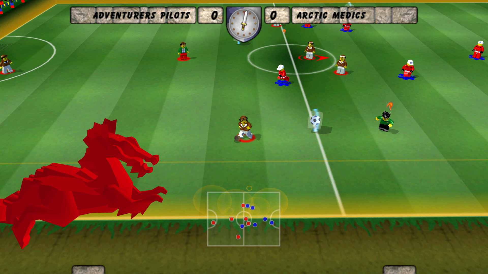

# OpenSoccerMania

**LEGO Soccer Mania / Football Mania · MatyMeatBoy · Windows x64 · 0.1.0-pre.8**

A modern Windows launcher and compatibility bridge for LEGO Soccer Mania / Football Mania. Bring your own game files.

OpenSoccerMania preserves and modernizes the original Windows edition of LEGO Soccer Mania / Football Mania. It runs the user-supplied original executable through version-checked compatibility and rendering bridges; it is not a console recompilation.

The portable launcher imports a private copy of supported game files, provides a bundled graphics backend, widescreen presentation, optional camera framing, graphics profiles and an in-game F1 panel. It supports independent controller slots and Xbox 360, PlayStation 4, Switch Pro and Steam Deck button-hint styles, with automatic detection and a manual override. Normal operation uses writable portable or per-user storage without requiring administrator rights.

This is an experimental prerelease. Complete campaign/tournament coverage, long-session timing/audio equivalence, all-map replay rendering and physical four-controller/4K/VRR/Steam Deck acceptance remain unfinished. Playable synchronized online matches, VRS and temporal AA are not implemented. No original game files are distributed.

## Install

[Development release](https://github.com/MatyMeatBoy/OpenSoccerMania/releases/tag/v0.1.0-pre.8)

Your own supported Windows copy of LEGO Soccer Mania / Football Mania, as an installed folder or supported disc image.

1. Extract the complete Windows ZIP into a new folder.
2. Run OpenSoccerMania.exe.
3. Choose your own supported game folder or disc image and prepare a private copy.
4. Adjust graphics and controls, then start the game.

## Actual runtime capture

This is an unaltered development-runtime capture, not an AI-generated gameplay image. The project icon is separate from the developer's GitHub avatar.

## Credits

Maintained by MatyMeatBoy. Original game by Silicon Dreams / LEGO / Electronic Arts. SDL, dgVoodoo, MinHook, Pillow and the Xelu CC0 controller glyph pack retain their upstream notices.

AI assistance is disclosed for code, project art and documentation. Original game imagery and trademarks belong to their respective rights holders.

## Catalog submission status

Prepared for Quiver Launcher and RecompLauncher review. **Not yet submitted**: authenticated portal access is required. This page is a reviewable draft, not a claim that either catalog accepted the project.

Original PC game compatibility/mod launcher, not a static recompilation. Please classify accordingly. Screenshot is an unaltered owner-game development capture, not a promise of complete game acceptance.

[Source repository](https://github.com/MatyMeatBoy/OpenSoccerMania) · [Developer](https://github.com/MatyMeatBoy)
